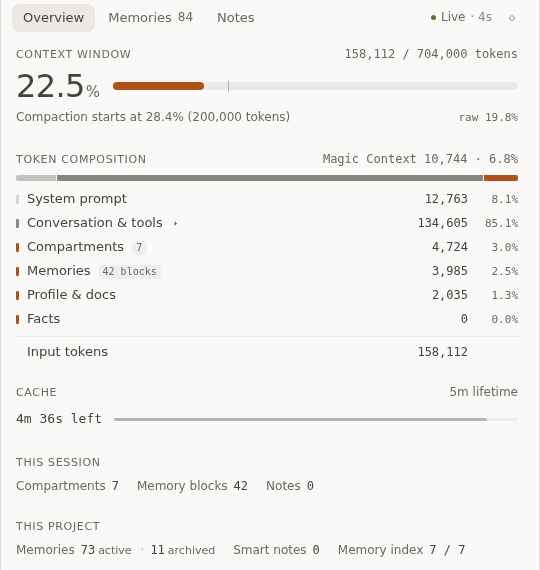

# Magic Context panel for OpenChamber

An OpenChamber extension that puts [Magic Context](https://github.com/cortexkit/magic-context) in the right-hand rail: context usage, token composition, cache lifetime, project memories, and session/smart notes, without leaving the chat.



> Unofficial. Not affiliated with CortexKit or the Magic Context project.

## What it shows

- **Overview** — context usage against the usable limit, compaction threshold, the nine token components from Magic Context's live RPC, cache TTL, and the active session/project counts. The composition always adds up to the reported input tokens; the service asserts it.
- **Memories** — the full project memory inventory, not only the budgeted block that is injected into the prompt. Search, filter by category or status, load more, and read the full text with importance, seen/retrieved counts, and timestamps.
- **Notes** — session notes and smart notes with their real status. Dismissed notes are hidden by default and revealed explicitly; they are never mixed into the active list.
- **Honest states** — no project session, no usage sample, a stale `session_meta` fallback, a schema mismatch between the database and the plugin, a missing database, or an unreachable RPC each have their own state. A failed source is labelled as unavailable instead of rendering an empty success.

The interface is built with Solid 2 inside the guest iframe and uses the host's `@openchamber/sdk/ui` primitives, so it follows the active OpenChamber theme instead of shipping a second skin. English and Simplified Chinese are included.

## Requirements

- OpenChamber **2.5.0 or newer**, on web or desktop. VS Code and mobile do not load extensions yet.
- Magic Context installed and running locally. Tested against **0.49.16**, database schema **95**.
- A local Magic Context database at `~/.local/share/cortexkit/magic-context/context.db`, or set `MAGIC_CONTEXT_DB` to its path before OpenChamber starts.
- A project session open in OpenChamber for live context data. A chat-only session shows a “no project session” state.

The panel is read-only. It never writes to `context.db`, never calls `ctx_memory`, and never changes Magic Context configuration.

## Install

1. Open **Settings → Extensions** in OpenChamber.
2. Paste the repository URL into **Folder, ZIP, or URL**:

   ```text
   https://github.com/gaojunran/openchamber-magic-context
   ```

3. Choose **Add**, then **Allow and enable**. The extension requests the `service` permission because it runs a small local read-only service; see [Security](#security).
4. Open a project session and click the brain icon on the right rail.

A git install is copied into OpenChamber's data folder and supports **Check for updates** in Settings → Extensions. To follow a tag, append `#v1.0.0` to the URL.

## Security

The extension declares a host-managed service. OpenChamber starts it with your user account; it is a normal process, not a sandbox. The service:

- binds only to `127.0.0.1` on a host-assigned port and requires a per-launch bearer token;
- opens Magic Context's `context.db` with `readOnly: true`;
- discovers Magic Context's private RPC through its port file and allows only `status-detail` and `sidebar-snapshot`;
- sends nothing to the network and has no telemetry.

Grant `service` only if you trust the code in this repository. The guest iframe itself is sandboxed and cannot reach your files or network directly.

## How it works

```text
OpenChamber rail
  └─ guest iframe (Solid 2 panel, sandboxed)
       └─ serviceRequest → host-managed service (127.0.0.1, bearer auth)
            ├─ Magic Context RPC  → live usage, composition, cache, thresholds
            └─ context.db (read-only) → memories, notes, compartments
```

The live RPC is the source of truth for current context state. `session_meta` is only a labelled fallback, because it can be stale. Content (memories and notes) only exists in SQLite, so those views read the database directly.

### Why “42 blocks” is not the number of memories

Magic Context injects a **budgeted** `<project-memory>` block (4,000 tokens by default) selected by importance, not every memory it stores. The Overview shows the injected block; the Memories tab shows the complete inventory, including archived rows. A memory can be active and still absent from the prompt. See [docs/DESIGN.md](docs/DESIGN.md) for the data semantics.

### Importance comes from Magic Context's classifier

New memories are written with importance 50. Magic Context's hidden `dreamer-classifier` scores them 1–100 later, using a text-only rubric. The panel shows the score as stored; an unclassified memory is labelled `50 · unclassified`. The panel does not assign or change it.

## Build from source

```sh
bun install
bun run build
bun run type-check
```

`panel/main.js` and `service/main.js` are committed so a git install works without a build step. After changing source, rebuild and reload the panel.

To develop against a local checkout, install the folder directly:

```text
Settings → Extensions → /absolute/path/to/openchamber-magic-context
```

A folder install runs from that path; edits appear after a rebuild and a panel reload.

## Compatibility

- Tested with OpenChamber **2.5.0+** and Magic Context **0.49.16** (schema 95) on Linux.
- The database path is resolved from `MAGIC_CONTEXT_DB` or `~/.local/share/cortexkit/magic-context/context.db`; other locations need the variable.
- Magic Context's RPC is private and may change. If the plugin reports a different supported schema, the panel downgrades affected sources to `partial` and shows the reason instead of silently returning empty data.
- Desktop and web are the supported hosts. Desktop-specific behavior and macOS/Windows database locations are untested.

## License

MIT. Magic Context is a separate project by CortexKit; this repository only reads its local data.
